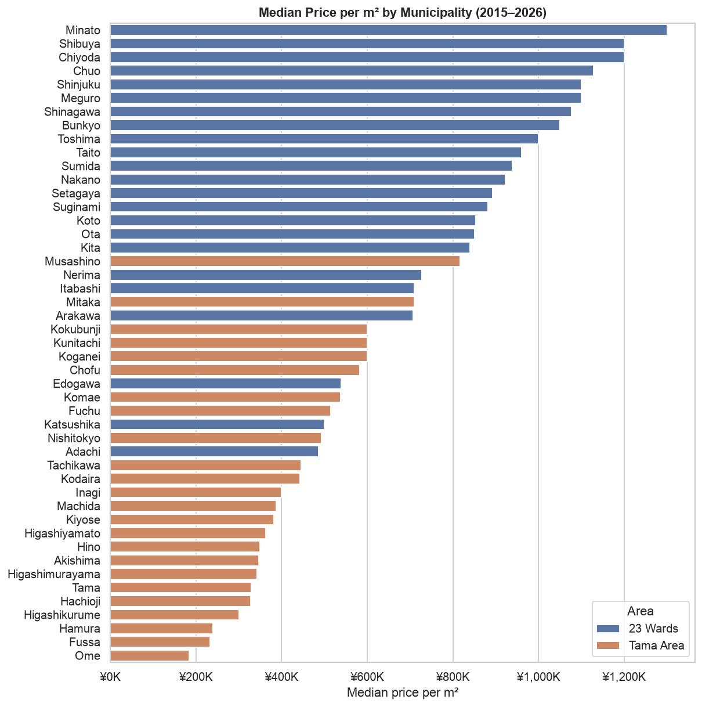
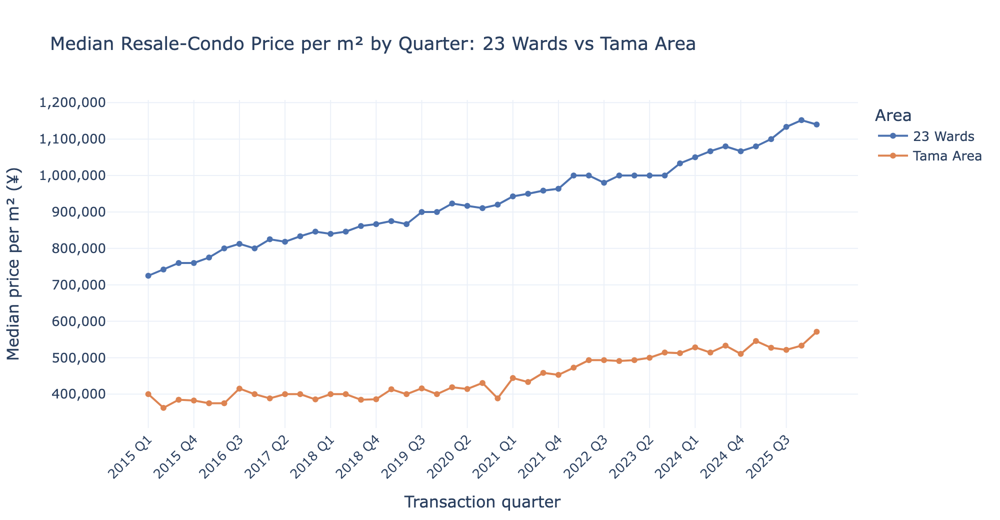
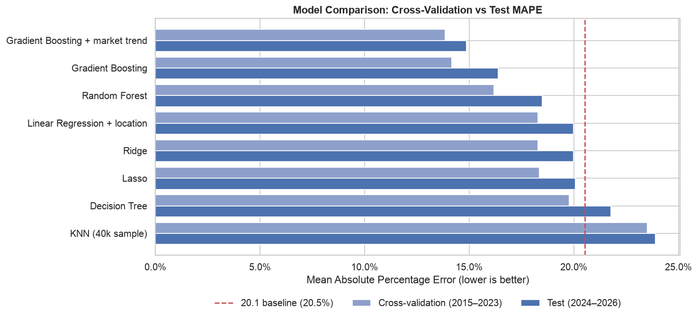
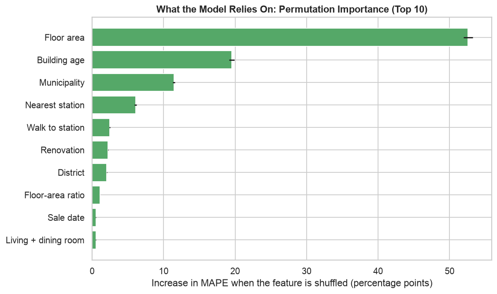
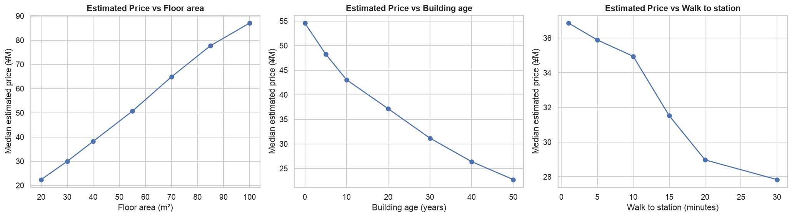
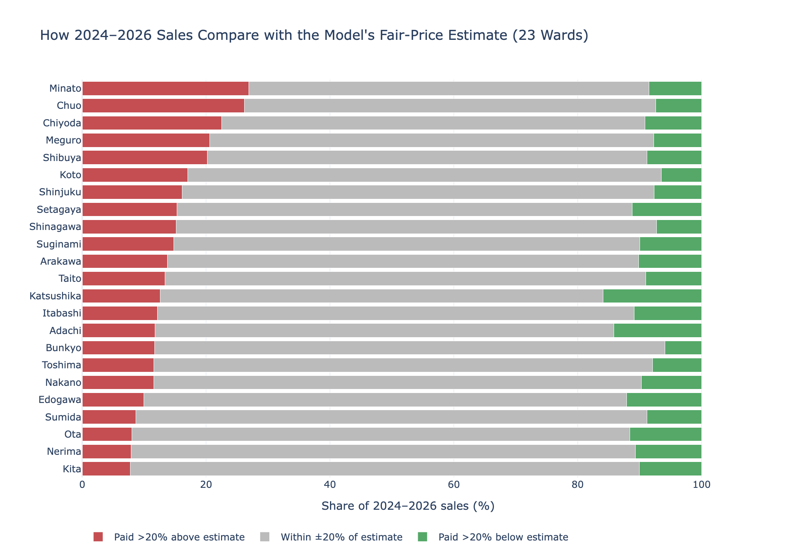

# What Drives Resale-Condo Prices in Tokyo?

**Sumit Mishra**

*UC Berkeley Professional Certificate in Machine Learning & AI — Capstone Project (Final Report, Module 24)*

---

## Executive Summary

**The problem**

Buying or selling a resale condominium in Tokyo is not always straightforward. It can be difficult to judge whether a property's price is reasonable because values vary significantly depending on location, floor area, building age, distance from the nearest station and the timing of the sale. Tokyo property prices have also increased considerably since 2015, making it even more important to understand what drives these differences.

**What I did**

I worked with **173,745 resale-condominium transactions in Tokyo, covering 2015 Q1 to 2026 Q1**, from data published by Japan's Ministry of Land, Infrastructure, Transport and Tourism (MLIT).

I started by cleaning the dataset and exploring the main factors associated with property prices. I then tested several of the EDA findings using statistical methods before training and comparing **seven models plus a market-trend adjustment** to estimate the market value of a resale condominium.

**What I found**

- **The best model predicts resale prices with a typical error of around 11%.** On sales from 2024–2026, which were kept separate from training, it achieved a MAPE of **14.86%**. That's a significant improvement over the initial Linear Regression baseline of 20.52%, reducing prediction error by approximately 28%.

- **Size, building age and location have the biggest influence on prices.** Distance from the nearest station also matters. Prices fall relatively little between a 1- and 10-minute walk, but the decline becomes much sharper beyond 10 minutes.

- **Renovation is associated with higher prices, particularly for older flats.** A simple comparison initially suggests that renovated properties are cheaper, mainly because they tend to be older. After accounting for building age and other factors, renovation is associated with an estimated **15.8% price premium**.

- **Tokyo property prices have risen by around 5% annually.** Between 2015 Q1 and 2025 Q4, median price per m² increased by **59% in the 23 wards** and **33% in the Tama Area**.

- **The model can help identify sales with unusual prices.** Around three out of four recent transactions were within ±20% of the model's estimate. In central wards such as Minato, Chuo and Chiyoda, roughly one in four sales was more than 20% above the estimated value.


#### Rationale

Buying a home is one of the biggest financial decisions most people make. In Tokyo, it can be difficult for buyers to know whether a resale condominium is fairly priced, especially when property values vary so much between locations and buildings. Buyers often depend on the selling agent's assessment, but having a data-based estimate provides another way to judge the price.

A reliable price estimate could help:

- **Buyers** identify potentially overpriced listings and negotiate with better information.
- **Sellers** set more realistic asking prices based on comparable transactions.
- **Lenders and investors** assess property values more quickly and consistently.

#### Research Question

*Which property characteristics have the greatest influence on resale-condominium prices in Tokyo, and can a machine learning model estimate transaction prices accurately enough to identify properties that may be overpriced or underpriced?*

### Data Sources

**Dataset:** Real Estate Transaction Price Information — *Used condominiums, etc.*, covering Tokyo from 2015 Q1 to 2026 Q1.

- **Publisher:** Japan’s Ministry of Land, Infrastructure, Transport and Tourism (MLIT), through the [Real Estate Information Library](https://www.reinfolib.mlit.go.jp/)
- **Original size:** 182,555 transactions across 21 columns, with data originally provided in Japanese
- **Information captured:** Transaction price, municipality, district, nearest station, walking time, floor area, layout (such as 3LDK), year built, building structure, zoning, renovation status and sale quarter.

**Change from the original Module 16 proposal**

My initial proposal was to predict payment-system failures using the PaySim synthetic payments dataset. However, PaySim does not include a failure label and covers only around 30 days of simulated activity, making it unsuitable for that objective. I therefore changed the project to focus on Tokyo resale-condominium prices, using a real-world public dataset with a clearly defined prediction target.

**Data Cleaning and Preparation** 

The data preparation process is covered in detail in Notebook 1. The main steps were:

- Translated the Japanese column names and values into English.
- Removed 1,282 non-market transactions, such as auctions and sales between relatives; 1,507 office and shop properties; 1,523 duplicate records; and 93 records with missing station walking times.
- Converted text-based fields into usable values, including walking-time ranges, pre-war construction dates and layout codes such as 3LDK.
- Filled missing construction years and zoning values using the typical value for the same neighbourhood.
- Removed 4,405 extreme-price records (2.5% of the data). Outliers were assessed within each municipality to avoid incorrectly removing expensive properties in central Tokyo.

**Final dataset: 173,745 transactions, retaining 95.2% of the original records.**

#### Methodology

| Step | What I did | Why |
|---|---|---|
| **Exploratory analysis** | Examined prices across locations, time periods, station distances, building ages, floor areas and layouts. | Identify the main patterns and factors associated with property prices. |
| **Statistical tests** | Used Kruskal–Wallis, Mann–Whitney U, chi-square and Spearman tests, alongside effect sizes. | Check whether the observed differences and relationships are statistically meaningful. |
| **Train/test split by time** | Trained on 2015–2023 transactions and tested on 2024–2026 transactions. | Reflect how a real pricing tool would work: use past sales to estimate the value of newer properties, without allowing future data into training. |
| **Seven models** | Compared Linear Regression, Ridge, Lasso, Decision Tree, KNN, Random Forest and Gradient Boosting. | Evaluate both simpler models and approaches that can capture more complex relationships. |
| **Hyperparameter tuning** | Used `GridSearchCV` with four-fold time-series cross-validation. | Find suitable model settings without using the held-out test data. |
| **Main evaluation metric** | Used Mean Absolute Percentage Error (MAPE). | Prices range from below ¥10M to above ¥300M, so percentage error makes it easier to compare prediction accuracy across properties of different values. |
| **Model interpretation** | Examined feature importance, what-if scenarios and prediction errors. | Understand which factors influence predictions and where the model performs well or less reliably. |

---

#### Results

##### 1. What the statistical analysis shows

| Question | Test | Result | In plain words |
|---|---|---|---|
| Do prices differ across Tokyo's 23 wards? | Kruskal–Wallis | p < 0.001, effect size ε² = 0.31 (large) | Prices vary substantially between wards, making location one of the strongest factors in the analysis. |
| Does renovation add value? | Regression controlling for age, size, location and sale date | **+15.8%** (95% CI: 15.5%–16.2%) | After accounting for other property characteristics, renovated flats sell for more. The apparent renovation penalty in the raw data was largely due to renovated properties being older. |
| How does the renovation association vary by building age? | Mann–Whitney U within age groups | 11–20 years: −4.0%; 21–30 years: **+10.0%**; 31–40 years: **+17.1%** | The positive association with renovation is stronger among older properties. |
| Do property layouts differ between central and outer Tokyo? | Chi-square | Cramér's V = 0.29 (medium) | Studios (1K) account for 33% of sales in the 23 wards, compared with 9% in Tama. Family-sized flats (3LDK) make up 48% of sales in Tama. |
| Does station distance matter within the 23 wards? | Spearman correlation | ρ = −0.24 | Properties closer to train stations generally sell for more. |

**Median price per m² by municipality**

*Location makes a substantial difference: the median price per square metre in Minato is about seven times that in Ome.*



**Price trend**

*Condominium prices rose steadily over the study period, with stronger growth in the 23 wards than in Tama. This market movement is an important reason for testing the models on more recent transactions.*



##### 2. Which model performed best?

| Model | Average error (MAPE) | Typical error (median APE) | Within ±10% | R² |
|---|---:|---:|---:|---:|
| **Gradient Boosting + market-trend adjustment** | **14.9%** | **11.1%** | **45.7%** | **0.91** |
| Gradient Boosting | 16.4% | 13.4% | 37.6% | 0.89 |
| Random Forest | 18.5% | 15.3% | 33.1% | 0.86 |
| Linear Regression with detailed location | 20.0% | 15.4% | 33.9% | 0.85 |
| Ridge | 20.0% | 15.4% | 33.9% | 0.85 |
| Lasso | 20.1% | 15.5% | 33.9% | 0.85 |
| *Baseline: Linear Regression (Module 20.1)* | *20.5%* | *15.8%* | *33.5%* | *0.84* |
| Decision Tree | 21.8% | 17.8% | 29.2% | 0.79 |
| KNN | 23.9% | 18.7% | 28.2% | 0.76 |
| *No-skill baseline (median-price prediction)* | *53.4%* | *38.8%* | *13.0%* | *−0.10* |

*All results are measured on 2024–2026 transactions held out from model training.*

**Model comparison**



The main findings from the comparison were:

- **Gradient Boosting performed best.** It can capture more complex relationships between property characteristics. For example, the effect of building age may vary depending on the property's location.
- **Adjusting for the market trend improved predictions.** Tree-based models cannot naturally extrapolate beyond the price patterns seen during training. As a result, the original Gradient Boosting model struggled to account for rising prices in 2024–2026. Separating the market trend from the property-level prediction and adding it back afterwards reduced MAPE from 16.4% to 14.9%.
- **The model generalises reasonably well to newer transactions.** MAPE was 11.8% on the training data and 14.9% on the held-out test data. The gap indicates some overfitting, but the test performance remains substantially better than the baseline.

##### 3. What the Model Relies On

**Feature importance**

Floor area has the greatest influence on the model's predictions, followed by building age and location. Location is captured through municipality, nearest station and district. Once floor area is known, the number of rooms adds very little additional information.



**What-if scenarios**

The following scenarios show how the model's estimated price changes when one property characteristic is varied while the others are held constant.

| If you change… | Estimated price change |
|---|---:|
| Walking distance: 1 → 10 minutes | **−5%** |
| Walking distance: 1 → 15 minutes | **−15%** |
| Walking distance: 1 → 30 minutes | −25% |
| Building age: new → 10 years | −21% |
| Building age: new → 30 years | −43% |
| Floor area: 20 m² → 55 m² | +126% |
| Renovation of a flat over 30 years old | **+33%** (¥24.0M → ¥32.0M) |



The station-distance results suggest that the price difference becomes more noticeable beyond a 10-minute walk. The renovation figure is a model-based what-if scenario; it should not be interpreted as a guaranteed return or confused with the +15.8% adjusted association from the statistical analysis.

##### 4. Using the Model: Flagging Unusual Prices

**Valuation flags by ward**

The model was used to compare each 2024–2026 transaction price with its estimated value:

- **75.3%** of sales were within ±20% of the model's estimate.
- **14.0%** sold for more than 20% above the estimate. This was most common in **Minato (26.9%), Chuo (26.2%) and Chiyoda (22.5%)**.
- **10.8%** sold for more than 20% below the estimate. This was most common in **Katsushika (15.9%), Adachi (14.2%) and Edogawa (12.1%)**.

These flags highlight transactions worth investigating further. They do not, on their own, establish that a property was overpriced or underpriced.



**Where the Model Performs Best**

| Property segment | Average error (MAPE) |
|---|---:|
| Typical, mid-priced flats | **10.7%–12.7%** (most reliable) |
| 23 wards | 14.2% |
| Tama area | 19.0% |
| Cheapest 20% of flats | 20.5% (tends to overestimate) |
| Most expensive 20% of flats | 17.2% (tends to underestimate) |

---

#### Recommendations

**For Buyers**

- Compare a listing's asking price with the model's estimate. A difference of more than 20% is a reason to investigate further or negotiate.
- Consider flats within a **10-minute walk of a station**. The model shows a growing price difference as walking distance increases beyond this point.
- Older, renovated flats may offer an attractive alternative to newer properties, depending on their condition and location.
- **Katsushika, Adachi and Edogawa** had the highest shares of sales priced below the model's estimates.

**For Sellers**

- Use the model estimate as a reference when setting an asking price. Around three out of four recent transactions were within ±20% of the estimate.
- For flats over 20 years old, renovation was associated with higher prices in the analysis.
- Central wards often command higher premiums, but those premiums should not be assumed to apply equally across Tokyo.

**For Lenders and Investors**

- Use the model as a quick, consistent second opinion alongside other valuation methods. Its median prediction error was approximately 11%.
- Apply additional checks to luxury properties, lower-priced flats and properties in the Tama area, where prediction errors were higher.
- Account for market movements when assessing property values. Prices increased by around 5% annually over much of the study period, with stronger growth in the 23 wards.

#### Limitations

- **Focuses on ordinary residential properties:** Luxury and distressed transactions were removed during data cleaning, so the model is not designed to value these properties.
- **Performance varies by property segment:** Predictions are less accurate for the cheapest and most expensive flats, as well as properties in the Tama area.
- **Market-trend assumption:** The trend adjustment assumes that the market growth observed during 2015–2023 remains a useful guide. A market slowdown or sudden increase could affect prediction accuracy.
- **Limited property details:** The dataset does not include floor level, views, building condition or management fees, all of which can influence a property's value.
- **Valuation flags require further investigation:** A difference between the actual price and model estimate is a signal for review, not proof that a transaction was incorrectly priced.

#### Next Steps

- **Bring in another data source:** Add station passenger numbers from MLIT's National Land Numerical Information to better capture station activity and connectivity.
- **Expand model tuning:** The best settings were at the edge of the search grid, so a wider search is worth testing. I would also like to compare XGBoost and LightGBM.
- **Retrain quarterly:** Update the model regularly to reflect changes in Tokyo's property market.
- **Add more property features:** Include distance to central Tokyo and more building-level information where available.
- **Build a simple web application:** Allow users to enter a property's details and receive an estimated price range.

---

#### Project Structure

| Notebook | Contents |
|---|---|
| [1. Data Cleaning, EDA and Inferential Statistics](notebooks/01_data_cleaning_and_eda.ipynb) | Data cleaning, outlier treatment, feature engineering, visual analysis and statistical tests. |
| [2. Modeling](notebooks/02_modeling.ipynb) | Seven models, time-series cross-validation, hyperparameter tuning and market-trend adjustment. |
| [3. Evaluation and Findings](notebooks/03_evaluation_and_findings.ipynb) | Prediction error analysis, feature importance, what-if scenarios, valuation flags and recommendations. |

- [Final capstone report (Word document)](reports/Capstone_Final_Report.docx)

**Additional project materials**
- Final capstone report (Word document).
- Initial Module 20.1 report: [Tokyo Condo Capstone EDA](https://github.com/Sumit-Misra/tokyo-condo-capstone-eda).

**Repository structure**

```
tokyo-condo-capstone-final/
├── README.md
├── requirements.txt
├── data/
│   ├── raw/          <- Original MLIT download (zipped)
│   └── processed/    <- Cleaned data and model comparison
├── notebooks/        <- Run in order: 01 → 02 → 03
├── models/           <- Saved best model
├── images/           <- Charts used in this README
└── reports/          <- Final report (Word)
```

**To reproduce the project**

Install the required packages and run the notebooks in sequence from the `notebooks` folder:

```bash
pip install -r requirements.txt
```

Then run notebooks `01`, `02` and `03` in order.

##### Contact and Further Information

**Sumit Mishra** — [GitHub](https://github.com/Sumit-Misra)

*Data source: Real Estate Information Library, Ministry of Land, Infrastructure, Transport and Tourism (MLIT), Japan: [https://www.reinfolib.mlit.go.jp/](https://www.reinfolib.mlit.go.jp/). The data was processed and analysed by the author.*
